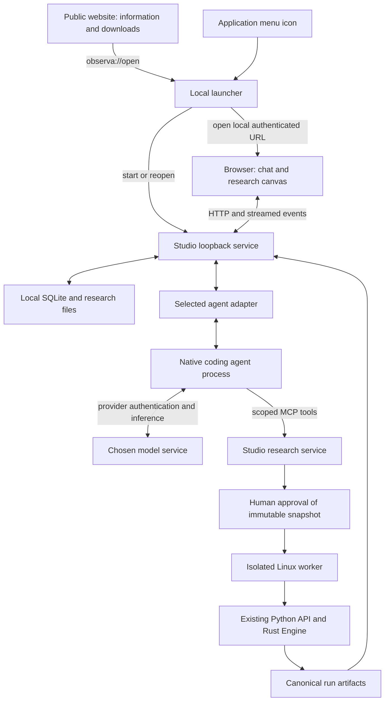

# Observa Studio: agents, local launch and distribution

Date: 2026-11-09. Task: [OBS-STUDIO-02](../agent_system/tickets/OBS-STUDIO-02.md).
Status: implementation plan; planned components are not claims of shipped support.

## 1. Goal and baseline

Install once, open Observa from an application icon or website link, choose a
supported coding agent, conduct approved research, inspect canonical results,
and resume later. Routine use must not require a terminal.

The existing Linux/Codex prototype lives on `obs-studio-mvp`, inspected at
`88ee0b4db486a05745d9ebb6b296a663c9acda4c`. It has a React/TypeScript UI,
authenticated loopback Python service, SQLite history, Codex App Server adapter,
scoped research MCP tools, isolated backtest workers and an integrated canvas.
At the time of this design, GitHub's default branch is `master`, at `4c5dbe93`;
it does not yet contain those six Studio development commits. This document
can land independently; integrating that baseline is milestone 0 below.

The [canonical architecture](ARCHITECTURE.md) remains authoritative. Rust owns
execution, accounting and metrics; Python strategies express intent; canonical
events are the authoritative history; charts present recorded evidence. Exact
position tickets, determinism and structural exclusion of future data remain
required. Python, CLI, read-only MCP and standalone replay remain compatible.

## 2. Component boundaries

| Component | Responsibility |
| --- | --- |
| Website | Discovery, setup documentation, verified downloads and a launch link. No access to research data or local credentials. |
| Launcher | Start/reopen one local instance, readiness checks, browser launch, diagnostics and controlled shutdown. |
| Studio service | Projects, conversations, provider selection, event persistence, approvals, experiments and artifact references. |
| Agent adapter | Translate a supported native agent protocol into Studio operations and presentation events. |
| Native agent | Planning, context management, file tools, command execution and its own model/authentication integration. |
| Research service and worker | Snapshot requests, obtain execution approval, isolate strategy validation/execution and register canonical evidence. |
| Browser canvas | Render canonical replay, metrics, drawings and trades; label agent interpretations separately. |

Local-first means local application storage and backtest execution. It does
not mean all AI inference is offline: a selected agent may send prompts, tool
output and project context to its model service under that provider's settings.
Onboarding must explain this accurately. No Observa account, inference proxy or
hosted research database is required.

## 3. Agent integration

Use a small explicit adapter registry, initially containing only Codex. Add
interfaces around existing behavior, then refine them while implementing Claude
Code. Do not build a plugin marketplace, generic agent framework or replacement
tool execution loop.

Proposed internal operations (names are design sketches, not existing APIs):

| Operation | Contract |
| --- | --- |
| `probe` | Resolve executable, version and authentication status with bounded timeouts. Return ready, missing, sign-in required, incompatible or unknown. Never infer signed-in from binary presence. |
| `setup` | Offer supported installation/authentication actions, with progress, cancellation and an explicit completion probe. |
| `capabilities` / `options` | Describe actual models, modes, permission choices and optional features for this installed version. |
| `start_or_resume` | Bind the project, provider configuration and scoped research tools to a native session. Return opaque native identifiers. |
| `send` / `events` | Submit one user turn and stream real message/tool/approval/status updates. |
| `respond` | Validate and forward only a native decision offered by the pending request. |
| `interrupt` / `close` | Interrupt natively, then clean up only owned subprocesses on a bounded timeout. |

Adapters own transport, protocol/version differences, native approval payloads
and credential integration. Studio owns its conversation state and presentation
event persistence. The orchestration layer must not inspect Codex-specific reader
tasks or process fields to decide whether an adapter is usable.

Normalize only the common presentation envelope: provider, conversation, native
session/turn/item IDs, message/tool/status kind, content and local event cursor.
Preserve provider-specific fields in a bounded, sanitized details payload when
needed for approvals or inspection. Never discard approval meaning to make all
providers look identical. Do not store secrets, raw credential files or complete
unfiltered protocol logs in SQLite.

Unsupported controls are unavailable with an explanation. Slash commands are
Studio controls backed by supported capabilities, not a promise to embed every
agent CLI command. Installation/authentication/compatibility probes should not
send a billable model request merely to render the setup screen.

### Session ownership and concurrency

- Each conversation is bound to one agent provider and one native session.
  Selecting a different agent creates a new conversation; optional explicit
  context handoff must be labeled as a handoff, never native session continuity.
- Keep provider identity separate from model backend identity. A model served
  by DeepSeek through another harness is not a DeepSeek Harness session.
- Preserve native account/configuration context without copying credentials.
  Account or backend changes that invalidate a session require an explicit new
  session; never silently reuse an incompatible thread identifier.
- Retain one active modifying turn per project across all providers. The lock
  spans pending approvals and stop cleanup, preventing concurrent project edits.
- Store item identities with their conversation/provider/session context;
  identifiers from two providers must not collide.
- Persist status/events before notifying the UI. Reconnection replays persisted
  events and reconciles native state where available; it never resubmits a
  possibly executed turn. A completed SDK request is not necessarily a completed
  agent turn: use the provider's terminal event.
- Restart expires pending approvals and marks unfinished work interrupted.
  Cancellation remains accessible after refresh and error. Confirmed stop must
  account for agent descendants and active workers, not just a browser spinner.

### Provider order and admission criteria

1. Codex: preserve the tested native App Server integration during extraction.
2. Claude Code: implement and verify against its current supported programmatic
   interface; use this second adapter to validate the shared boundary.
3. Cursor Agent and DeepSeek Harness: separate compatibility investigations and
   adapters, admitted only after the same real workflow passes.

For each provider, verify streaming, file changes, MCP research integration,
native permissions, stop, resume, authentication and supported versions. Check
current provider terms and whether programmatic integration supports the user's
account type; do not assume a consumer subscription covers every SDK mode. If a
provider cannot meet safe execution requirements, leave it unavailable rather
than compensating with unrestricted execution or a custom harness.

## 4. Research execution and permission boundaries

Keep the existing Studio research tools: `get_project_context`,
`prepare_backtest`, `get_experiment`, and `publish_artifact`. Inject them through
each provider's supported mechanism using a short-lived conversation-scoped
credential. Do not alter the existing read-only `observa mcp` API.

The Studio execution path is:

1. Agent edits strategy files in the selected project.
2. `prepare_backtest` copies and hashes source, declared support files, data,
   configuration and environment metadata.
3. User reviews and approves that exact snapshot in Studio.
4. Worker validates and executes it through the existing Python/Rust engine.
5. Canonical run artifacts are linked to the conversation and experiment.
6. UI and agent inspect those artifacts; absent metrics remain unavailable.

Native agent approvals and Studio backtest approval are distinct. Native
automatic review never approves a Studio experiment. Strategy imports and smoke
validation execute code and therefore belong inside the approved worker path.

The Studio gate protects this managed execution path; it is not an OS-wide
prohibition on commands available to a coding agent. Native sandbox/permission
policies still determine what shell tools can execute. Preserve that distinction
in the UI and documentation; instructions alone do not create a security boundary.
Unsupported permission mappings must fail closed. Do not relax worker isolation
to accommodate a provider or packaging format.

## 5. Launcher and local service lifecycle

Start with a thin Linux launcher using the packaged runtime and existing browser
UI. Reuse the Python service and desktop-entry integration. An embedded Tauri or
Electron window is not needed for this increment; reconsider only for a concrete
native UI requirement that the browser and a small startup dialog cannot meet.

Use an application-menu desktop entry with `Terminal=false`. Resolve installed
executables explicitly; GUI processes cannot depend on an activated virtualenv
or interactive shell configuration. Probe selected agent paths without sourcing
shell startup scripts. Missing binaries produce a guided setup action.

Launcher sequence:

1. Locate the existing XDG data directory and acquire its instance lock.
2. If a live owner exists, ask it to create a fresh local launch URL and open it.
3. Otherwise start the local service, bind `127.0.0.1` on port zero while retaining
   the socket, wait for readiness, then open the browser.
4. On timeout/failure, show a small local recovery dialog with retry and redacted
   diagnostics. Never require the user to retrieve a URL from a terminal.

Use a per-user private Unix socket under the XDG runtime directory for the small
launcher control channel (reopen/status/shutdown), with restrictive permissions
and peer identity checks. Keep the authoritative data-directory lock; stale PID
or port files alone are not proof of ownership. Do not kill processes by name.
If the runtime directory is unavailable, use a verified user-private fallback
with the same ownership protections.

The service creates short-lived, single-use bootstrap tokens exchanged for its
local session cookie. Tokens are never embedded in website links, logs or
download metadata. Preserve Host/Origin validation, authenticated APIs and SSE;
do not enable cross-origin research access for the public website.

Closing a browser tab leaves active local research running. Reopening the icon
reconnects. A visible Quit Studio action warns about active work, stops owned
agents/workers and closes the service. No always-on system daemon or login
autostart is needed initially. Process crash recovery settles unfinished state
without automatically rerunning experiments.

## 6. Persistence and upgrades

Retain SQLite WAL and the existing XDG data/project layout. Store projects,
conversations, presentation events, settings, approvals, experiment metadata and
artifact references locally. Keep large datasets and canonical run files on the
filesystem, outside the application installation directory. Native session
history remains provider-owned; Observa stores the references needed to resume.

Migrate current Codex records in place: default legacy provider fields to Codex,
preserve thread IDs and settings, and keep all existing conversations readable.
Replace unconditional schema-version initialization with explicit ordered,
transactional migrations. Back up consistently with SQLite's backup mechanism
before a migration; refuse unknown newer schemas rather than rewriting them.
Test interrupted migrations and recovery. A database backup alone is not a full
research backup: datasets, run artifacts, projects and native history also matter.

Application upgrade must not overwrite research. Apply updates with the service
stopped, verify packages before activation, and provide recovery for failed
upgrades. Binary rollback is allowed only with a compatible data schema or an
explicitly restored backup. Uninstall removes the application while retaining
research by default. Broad data deletion is a separate explicit user action.

## 7. Installer, setup and website

First distribution target: a Debian package for a declared, tested Linux x86_64
baseline. Choose exact distro releases after clean-machine packaging tests;
do not imply every Debian/Ubuntu derivative is supported. AppImage is a later
fallback if sandbox and desktop integration tests justify it.

Package the prebuilt Rust extension, built frontend, application Python runtime
and pinned dependencies, launcher and desktop assets. Declare necessary OS
dependencies such as bubblewrap. End users need no repository, Rust compiler,
Node, pip commands or manual virtualenv. Keep build tools in CI. A bundled Python
runtime must still support worker imports and provider MCP subprocess launch.

Agent packages remain separate from Observa's runtime. Reuse detected compatible
installations. Setup offers user-initiated installation and provider-owned sign-in
only after validating the supported distribution/authentication flow and terms.
Do not silently install all agents, overwrite their global configuration, copy
their credentials or update them during a running conversation. Show readiness
per agent, including incompatible versions and authentication errors. A private
launcher prototype may require an existing agent; the public nontechnical
acceptance gate requires completing setup without terminal commands.

The static website supplies information, download links, versions and a button
for `observa://open` (also accepting the equivalent root slash added by GIO).
The installed handler validates the complete URI
and rejects other actions, parameters, paths and commands. The browser may ask
permission to open the app. When launch cannot be confirmed, show Install/Open
help instead of claiming reliable installed-app detection. The website neither
polls private research APIs nor receives local session tokens.

Use authenticated distribution and verifiable package/update signatures with an
explicit key-management process before public distribution. A checksum served
alongside an untrusted download is not sufficient provenance. Initial updates
may be manual verified package upgrades; an automatic updater is deferred.
Website hosting would host only static content, not Observa execution. Publishing,
release tags, public assets, paid services and signing-key creation are separate
actions requiring explicit authorization.

## 8. Implementation sequence and completion gates

| Milestone | Deliverable | Required evidence before primary-branch integration |
| --- | --- | --- |
| 0. Baseline integration | Integrate the existing Studio commits and enable Studio checks in CI | Existing Rust/Python regressions, frontend tests/build, Studio service/worker tests and real Codex research/restart; preserve historical evidence and record any account blockers. |
| 1. Agent boundary | Extract Codex into a small registry/adapter contract; provider-aware UI and migrations | Legacy conversation upgrade; native settings/approval choices preserved; cancellation, streaming, scoped credentials and provider-ID isolation tests. |
| 2. Local launcher | Application icon, single-instance reopen, readiness/recovery, Quit | Actual desktop launch without terminal, repeated clicks, stale locks, port collision, no shell PATH dependency, stop/restart, crash recovery and offline history access. |
| 3. Claude Code | Second real adapter and onboarding path | Live strategy authoring, approval, canonical execution, result inspection, stop and native resume for each supported agent; document account/version constraints. |
| 4. Installer | Private installable Linux package, dependency/setup checks and upgrades | Clean supported VM without developer tooling; first run/sign-in; sample backtest; restart; upgrade/migration; uninstall preserving data; sandbox isolation still holds. |
| 5. Website integration | Static launch/download page and registered open link | Installed/uninstalled flows, browser confirmation, malformed-link rejection and no website access to research APIs; public deployment remains gated. |
| 6. Additional agents | Cursor Agent, then DeepSeek Harness, subject to compatibility findings | Same real lifecycle and execution gates; no feature-parity claims based only on mocked transport tests. |

Test adapters with recorded protocol fixtures for failure paths and live provider
sessions for acceptance. Financial changes are outside this plan; if one becomes
necessary, stop and obtain independent Finance/QA verification. Never substitute
fabricated model responses or run metrics when live verification is unavailable.

For changes affecting persisted state, shutdown, permissions or execution, tests
must exercise errors as well as success. CI needs a supported Node version for
Studio's TypeScript tests/build and Linux sandbox availability for worker tests.
Record results, actual supported versions and remaining gaps in each milestone's
ticket before declaring it complete.

## 9. Repository workflow and deferred scope

The user authorized pushes to the primary branch on 2026-11-09. Its current
GitHub name is `master`, not `main`; preserve that name unless asked to rename it.
Use isolated working branches/worktrees for implementation and review, then
ordinary fast-forward or reviewed merge pushes to the primary branch after
relevant checks pass. Never force-push, bypass branch protection or discard
concurrent work. If protection requires a PR, follow that route. Push code is
not release authorization: no release tag, published installer or website deploy
without a separate request.

Keep updates in small complete increments with linked tickets, tests, migration
notes and verification evidence. This design commit does not merge the Studio
runtime or claim the future launcher/providers are implemented.

Deferred: Windows/macOS, embedded desktop webview, plugin marketplace, automatic
agent updates, arbitrary project-opening deep links, cross-provider native thread
conversion, simultaneous editing agents per project, hosted execution/cloud sync,
live trading and replacement agent harnesses.
